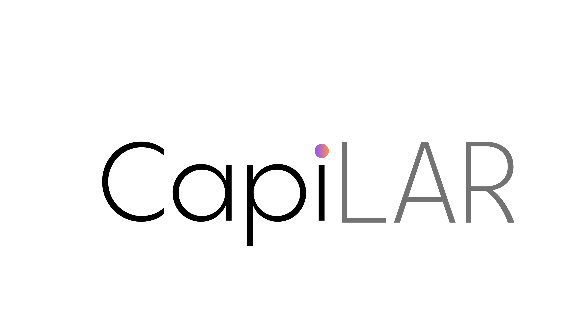

<p align="center">
  
</p>

<h3 align="center">Gestión operativa y técnica para salones de peluquería</h3>

<p align="center">
  Trabajo Práctico N°2 · Frameworks e Interoperabilidad 2026<br>
  Tecnicatura Universitaria en Desarrollo Web · Facultad de Informática · Universidad Nacional del Comahue
</p>

---

## Sobre el proyecto

**CapiLAR** es una aplicación web pensada para la administración diaria de salones de peluquería y estilistas profesionales. Se desarrolla junto a dos profesionales del rubro, que aportan los requerimientos reales y prueban cada avance.

### Problemas que resuelve

- **Pérdida de trazabilidad técnica:** los estilistas rara vez tienen un historial centralizado de los procesos químicos previos de cada cliente (fórmulas, volúmenes de oxidante, tiempos de exposición).
- **Falta de control en costos e insumos:** el consumo de productos se calcula de forma inexacta, lo que genera desfasajes de stock y márgenes de ganancia poco confiables.
- **Rigidez en los sistemas de turnos:** las soluciones habituales no contemplan turnos periódicos fijos ni vinculan la cita con la ficha técnica del cliente.
- **Diagnóstico subjetivo:** la evaluación del daño capilar depende solo del criterio visual del momento, sin un análisis histórico cruzado.

### Visión del producto final

| Módulo | Descripción |
|---|---|
| Gestión de turnos | Agenda según duración del servicio y horarios del profesional. Turnos puntuales o fijos, recordatorios por WhatsApp a clientes y agenda diaria por email a profesionales. |
| Fichas técnicas e historial | Registro de colorimetría, oxidantes, tratamientos, diagnósticos, tiempos de pose y fotos evolutivas. |
| Inventario automatizado | Descuento de insumos al registrar la ficha técnica, gestión de stock por QR y gestión de proveedores. |
| Diagnóstico asistido por IA | Evalúa daño, porosidad e intervenciones químicas previas para recomendar servicios, productos y alertar incompatibilidades. |

---

## Alcance de esta entrega (TP2)

Esta entrega se centra en la **interoperabilidad entre el frontend en React y un CMS Headless (Strapi)**:

1. **Template CSS adaptado:** se partió de la plantilla Tailwind *BarberShop UI Kit* y se adaptó a la identidad de CapiLAR (tema claro, paleta violeta/durazno, interfaz en español, logotipo y tarjetas de los módulos principales).
2. **Catálogo de servicios:** colección `Servicio` en Strapi consumida en tiempo real desde React (`GET /api/servicios`).
3. **Autenticación (Log In):** login contra el plugin *Users & Permissions* de Strapi (`POST /api/auth/local`). El JWT y el usuario se guardan en `localStorage` para mantener la sesión.
4. **Historial y ficha técnica** *(en desarrollo)*: colección `Ficha-Tecnica` consumida con el token en la cabecera `Authorization: Bearer <jwt>`.

---

## Arquitectura

Arquitectura **Headless**: el frontend, el backend y la gestión de contenidos están desacoplados y todo el ecosistema usa TypeScript sobre Node.js.

```
┌─────────────────────┐        REST / JSON        ┌──────────────────────┐
│  Frontend           │  ───────────────────────▶ │  CMS Headless        │
│  React + Vite       │   GET  /api/servicios     │  Strapi 5            │
│  Tailwind CSS       │   POST /api/auth/local    │  Users & Permissions │
│  localhost:5173     │ ◀───────────────────────  │  localhost:1337      │
└─────────────────────┘                           └──────────────────────┘
```

### Stack

| Capa | Tecnología | Estado |
|---|---|---|
| Frontend | React 19, Vite, TypeScript, Tailwind CSS 4 | ✅ En uso |
| CMS | Strapi 5 (SQLite en desarrollo) | ✅ En uso |
| Backend | NestJS + TypeScript | 🔜 Próximas etapas |
| ORM / Base de datos | Prisma + MySQL | 🔜 Próximas etapas |
| App móvil | React Native + Expo (APK) | 🔜 Próximas etapas |

### ¿Por qué estas tecnologías?

- **Strapi** (frente a Ghost y KeystoneJS): su Content-Type Builder permite modelar colecciones propias del dominio (servicios, insumos, precios) sin programar, genera endpoints REST automáticamente y su panel es usable por personal no técnico del salón. Ghost está atado a blogs y KeystoneJS expone los datos solo por GraphQL.
- **NestJS** (frente a Express y Fastify): arquitectura modular con inyección de dependencias, integración nativa con Prisma y módulos aislados para turnos, IA e inventario.
- **React** (frente a Angular y Vue): el conocimiento se transfiere a React Native para la futura app móvil, tiene un ecosistema enorme (calendarios, lectores QR, subida de fotos) y es el estándar más documentado para consumir Strapi.

---

## Estructura del repositorio

```
.
├── cms/                         # Strapi 5 (CMS Headless)
│   ├── config/                  # Configuración de servidor, BD, admin y plugins
│   ├── src/api/servicio/        # Colección "Servicio" (tipo, tiempo_duracion, precio)
│   └── .env.example             # Variables de entorno de ejemplo
└── frontend/                    # React + Vite + Tailwind CSS
    ├── public/                  # Logo, fondo e íconos
    └── src/App.tsx              # Vistas, login y consumo de la API
```

### Modelo de datos actual

**Servicio** (`/api/servicios`)

| Campo | Tipo |
|---|---|
| `tipo` | Texto |
| `tiempo_duracion` | Entero (minutos) |
| `precio` | Entero (ARS) |

---

## Instalación y ejecución

### Requisitos

- Node.js `>= 20`
- npm

### 1. Clonar el repositorio

```bash
git clone https://github.com/Andre-C96/TUDW_Frameworks_Interoperabilidad_LARDevelopers.git
cd TUDW_Frameworks_Interoperabilidad_LARDevelopers
```

### 2. Levantar el CMS (Strapi)

```bash
cd cms
cp .env.example .env      # completar los secretos con valores propios
npm install
npm run develop
```

- Panel de administración: http://localhost:1337/admin
- En el primer arranque se crea el usuario administrador.

**Permisos necesarios** (*Settings → Users & Permissions → Roles*):

- **Public:** habilitar `find` y `findOne` en *Servicio*.
- **Authenticated:** habilitar `find` y `findOne` en *Ficha-Tecnica*.

Para probar el login, crear un usuario en *Content Manager → User* con `confirmed = true`.

### 3. Levantar el frontend

En otra terminal:

```bash
cd frontend
npm install
npm run dev
```

La aplicación queda disponible en http://localhost:5173.

### Scripts útiles

| Carpeta | Comando | Descripción |
|---|---|---|
| `cms` | `npm run develop` | Strapi en modo desarrollo (con autoreload) |
| `cms` | `npm run build` | Compila el panel de administración |
| `cms` | `npm run start` | Strapi en modo producción |
| `frontend` | `npm run dev` | Servidor de desarrollo de Vite |
| `frontend` | `npm run build` | Build de producción |
| `frontend` | `npm run lint` | Análisis con ESLint |

---

## Flujo de trabajo

- `main`: versión estable para entregas.
- `developer`: rama de integración.
- `feature/*`: una rama por funcionalidad, integrada a `developer` mediante Pull Request.

---

## Equipo — LAR Developers

| Integrante | Legajo |
|---|---|
| Crespillo, Andrea | FAI-5546 |
| Navarrete, Ramiro Rafael | FAI-5522 |
| Parra Sanhueza, Linda Cristal | FAI-5568 |

---

## Referencias

- [React](https://react.dev/)
- [Strapi](https://docs.strapi.io/)
- [Tailwind CSS](https://tailwindcss.com/)
- [Vite](https://vite.dev/)
- [NestJS](https://docs.nestjs.com/)
- Plantilla base: *BarberShop UI Kit*
